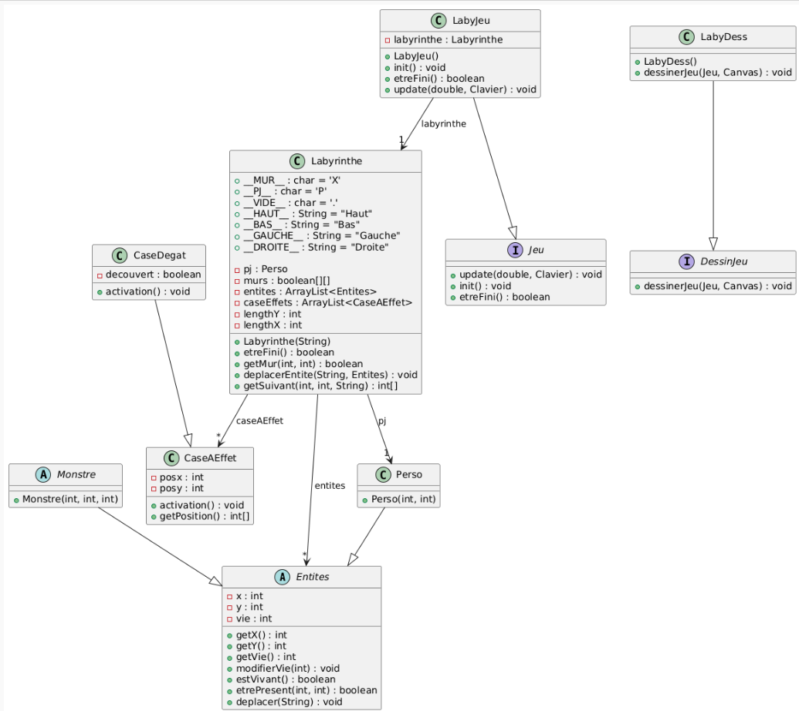
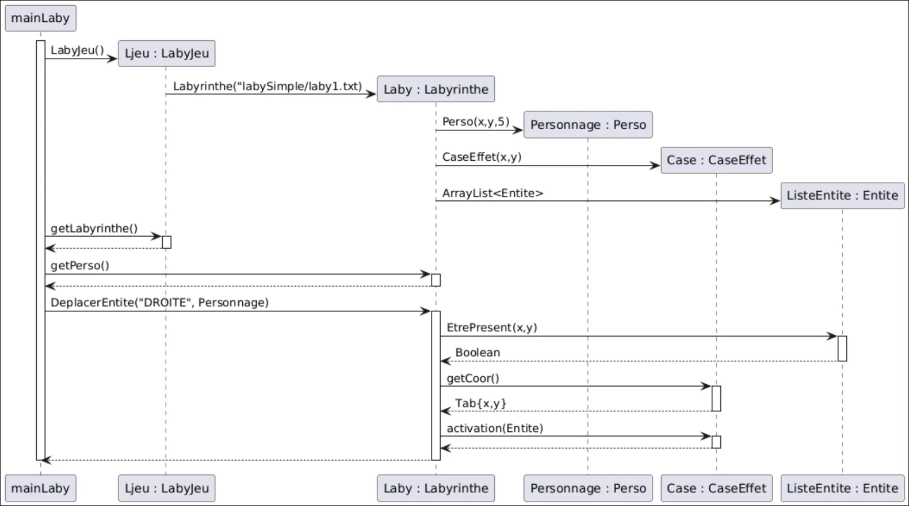

# Deuxième itération :

## Fonctionnalité 1.4 : Case à effets

<aside>

**Methodes et attributs :** Martin, Yanis

**Implementation :** Jassem, Martin, Logan

**Séquence :** Alexis

**Classe :** Yanis

**Tests :** 

</aside>

***Deux options s’offrent à nous :*** 

- 1 classe `CaseAEffet` prenant un argument `TypeAEffet`
- 1 classe `CaseAEffet` et des classes `CaseXX extends CaseAEffet`

**Nous avons choisi :** 

<aside>

- 1 classe `CaseEffet` et des classes `CaseXX extends CaseAEffet`
</aside>

### **Classes à créer :**

- Classe  “CaseEffets”

### Classe Labyrinthe—————————

**Attributs à créer** : 

- liste de cases à effet

**Méthodes à créer :**

- Génerer des CaseAEffet dans le constructeur `Labyrinthe()`

**Méthodes à modifier :**

- Gérer collision avec case dans `deplacerEntite()`

### Classe CaseEffet—————————

**Attributs à créer** : 

- x
- y
- nomEffet

**Méthodes à créer** : 

- `activation(Entite)`
- `getCoord()`  (retourne un tableau de coordonnée [x,y])

Critères de validation :
• Les cases avec effet sont des cases traversables.
• Lorsqu'un personnage (héros ou monstre) marche sur cette case, elle déclenche
immédiatement un effet
• cet effet se traduit pour le moment, par un affichage dans la console à préciser.

## Tests

`les cases sont traversable par le joueur.` 

`les cases doivent être traversable par le joueur.`

diagramme de classe :

diagramme de séquence de activation :

